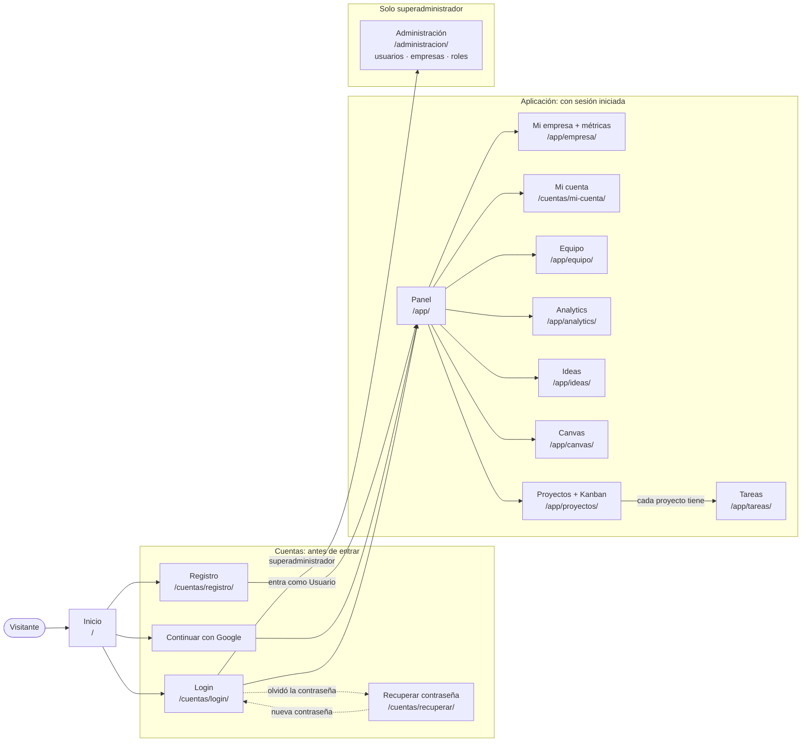

# Xincronix

Xincronix es una plataforma web donde las empresas organizan el trabajo de
sus equipos en un solo lugar: proyectos, tareas, ideas y una pizarra
compartida, con indicadores para ver cómo avanza todo.

---

## Product Goal

> Que cualquier empresa pueda organizar, repartir y seguir el trabajo de sus
> equipos desde una sola plataforma, donde cada persona ve solo lo que le
> corresponde.

**Entrega:** 1 de diciembre de 2026.

---

## Partes del proyecto

Para usar cualquier módulo primero hay que **registrarse** (con correo o con
**Google**) e **iniciar sesión**. Quien se registra queda como **Usuario**:
crea su propia empresa, sus proyectos e invita a quien necesite. El único que
asigna roles (incluido Administrador) es el **superadministrador**.

| Módulo | Para qué sirve | Ruta | Necesitas antes |
|---|---|---|---|
| **Cuentas** | Crear la cuenta, entrar (correo o Google) y recuperar la contraseña | `/cuentas/registro/` · `/cuentas/login/` | — |
| **Mi cuenta** | Ver, editar o eliminar la propia información | `/cuentas/mi-cuenta/` | Iniciar sesión |
| **Panel** | Ver de un vistazo cómo va el trabajo | `/app/` | Iniciar sesión |
| **Mi empresa** | Crear la empresa, editarla y ver sus métricas | `/app/empresa/` | Iniciar sesión |
| **Administración** | CRUD de usuarios y empresas, asignar roles | `/administracion/` | Ser superadministrador |
| **Empresas y equipos** | Agrupar a las personas de la empresa en equipos, con su rol | `/app/equipo/` | Ser Administrador o Manager |
| **Proyectos** | Crear proyectos, sumar miembros y organizarlos en un Kanban | `/app/proyectos/` | Iniciar sesión |
| **Tareas** | Repartir el trabajo con responsable, prioridad y fecha | `/app/tareas/` | Tener un proyecto |
| **Analytics** | Medir el avance frente a las metas | `/app/analytics/` | Tener tareas |
| **Tablero de ideas** | Proponer y votar ideas en equipo | `/app/ideas/` | Iniciar sesión |
| **Canvas** | Diseñar en conjunto sobre una pizarra compartida | `/app/canvas/` | Iniciar sesión |

Todo funciona en **modo claro y oscuro**.

### Recorrido del usuario



### Ejemplo: crear un proyecto

1. **Regístrate** en `/cuentas/registro/` (o con **Continuar con Google**).
2. Llegas al **Panel** (`/app/`) y creas **Mi empresa**.
3. En **Proyectos**, pulsa **Nuevo proyecto** y llena nombre, tipo, importancia y fechas.
4. En el proyecto, **agrega personas por su correo** (pueden ser de otra empresa) con su rol:
   responsable, editor u observador.
5. Crea las **tareas** con responsable y fecha límite. Tú y quienes agregaste
   ajustan fechas, estados y tareas; el avance y las métricas se calculan solos.

### Qué puede hacer cada quien

Las reglas viven en [`config/politica_accesos.json`](config/politica_accesos.json)
(sin `if` en el código). Guía: [`docs/roles_y_accesos.md`](docs/roles_y_accesos.md).

| En un proyecto | Ver | Editar datos y fechas | Tareas | Miembros | Eliminar |
|---|---|---|---|---|---|
| Creador | ✅ | ✅ | ✅ | ✅ | ✅ |
| Responsable | ✅ | ✅ | ✅ | ✅ | ❌ |
| Editor | ✅ | ✅ | ✅ | ❌ | ❌ |
| Observador | ✅ | ❌ | ❌ | ❌ | ❌ |
| Administrador de la empresa | ✅ | ✅ | ✅ | ✅ | ✅ |

El **superadministrador** (`cuellaryohan100@gmail.com`) entra a `/administracion/`,
crea empresas y las vincula con usuarios, y es el único que asigna roles.
Además tiene un **panel de monitoreo** (`/administracion/monitoreo/`) para vigilar
toda la base de datos: tablas y filas, alertas, sesiones activas, migraciones y
estado del sistema. Guía: [`docs/monitoreo.md`](docs/monitoreo.md).

---

## Sprint actual — Sprint 2

| Módulos | Responsable | Fechas |
|---|---|---|
| Empresas y equipos · Panel | Felipe ([@FelipeNavarrete0313](https://github.com/FelipeNavarrete0313)) | 16 – 20 de noviembre de 2026 |

### Sprint Goal

> Cada empresa organiza a su gente en equipos y conoce de un vistazo el estado
> real de su trabajo, sin tener que preguntarle a cada persona.

**Qué entrega este sprint:**
- Cada empresa tiene sus propios usuarios, roles y equipos, separados de las demás.
- Cada persona ve solo los proyectos y la información que le corresponden.
- El panel muestra el resumen real del trabajo: proyectos activos, tareas
  completadas y vencidas, actividad reciente y avance de cada proyecto.

El plan de todos los sprints (historias de usuario, story points y criterios
de aceptación) está en [`docs/plan_sprints.md`](docs/plan_sprints.md).

---

## Tecnologías y requisitos

- **Python 3.10+** con **Django 5.2** y **django-allauth** (inicio con Google)
- **Base de datos:** MariaDB 10.5+ / MySQL 8+, SQLite o PostgreSQL
- **Interfaz:** Bootstrap 5.3, Bootstrap Icons y Chart.js
- **Git** y **pip**

> El XAMPP con MariaDB 10.4 **no** es compatible con Django 5.2.

---

## Instalación

```bash
# 1. Clonar el repositorio
git clone https://github.com/kevincomunicate-tech/XINCRONIX.git
cd XINCRONIX

# 2. Crear y activar el entorno virtual
python -m venv .venv
#    Windows (PowerShell):  .venv\Scripts\Activate.ps1
#    Linux / macOS:         source .venv/bin/activate

# 3. Instalar las dependencias
pip install -r requirements.txt

# 4. Crear el archivo .env (y cambiar la clave secreta)
#    Windows:        copy .env.example .env
#    Linux / macOS:  cp .env.example .env

# 5. Crear las tablas de la base de datos
python manage.py migrate

# 6. Crear el superadministrador (usa el correo de config/politica_accesos.json)
python manage.py createsuperuser

# 7. (Opcional) Inicio con Google: ver docs/google_login.md

# 8. (Opcional) Datos de ejemplo en la empresa de un usuario que ya exista.
#    Si no tiene empresa, se le crea "Empresa demo" (queda como propietario).
python manage.py cargar_demo tu@correo.com

# 9. Iniciar el servidor
python manage.py runserver
```

Abre http://127.0.0.1:8000

### Uso diario

```bash
source .venv/bin/activate      # o .venv\Scripts\Activate.ps1 en Windows
python manage.py migrate       # por si alguien cambió los modelos
python manage.py runserver
```

Si instalas un paquete nuevo: `pip install paquete` y luego `pip freeze > requirements.txt`.

En desarrollo, los correos de **recuperar contraseña** no se envían: se
imprimen en la terminal donde corre `runserver`.

---

## Base de datos

El motor se elige en `.env` con `DB_ENGINE`: **mysql** (MariaDB de XAMPP, por
defecto), **sqlite** o **postgresql**. Crea la base vacía `xincronix_bd`
(`utf8mb4_unicode_ci`), configura `.env` (ver `.env.example`) y corre
`python manage.py migrate`. Paso a paso en
[`docs/guia_base_de_datos.md`](docs/guia_base_de_datos.md).

El diagrama entidad-relación está en [`docs/modelo_datos.md`](docs/modelo_datos.md)
y la estructura en SQL en [`docs/xincronix_bd.sql`](docs/xincronix_bd.sql).

> Borra los datos desde la aplicación o desde `/admin`, no con `DELETE`
> directo en phpMyAdmin.

---

## Estructura

```
XINCRONIX/
├── config/          configuración general (settings, urls)
├── cuentas/         cuentas, empresas, roles, equipos, política de accesos y Google
├── administracion/  panel del superadministrador (usuarios, empresas y monitoreo)
├── dashboard/       panel, proyectos, tareas, analytics, ideas y canvas
├── comunicacion/    mensajes, reuniones, calendario, asistente IA y soporte
├── sitio/           página pública de inicio
├── templates/       plantillas base
├── static/          CSS, JS e imágenes
├── docs/            modelo de datos, guías y plan de sprints
├── sql/             consultas de solo lectura para revisar los datos
├── scripts/         publicar el backlog en GitHub
├── requirements.txt dependencias
└── .env.example     guía para crear .env
```

---

## Pruebas

```bash
python manage.py test
```

---

## Flujo de trabajo con Git

- `main` solo recibe cambios revisados.
- Cada historia va en su propia rama: `feature/HU-18-listado-proyectos`.
- Los cambios entran por **pull request**, revisado por otra persona.
- En el pull request escribe `Closes #N` para cerrar el issue al unirlo.

### Definición de terminado

Una historia está terminada cuando cumple sus criterios de aceptación, tiene
pruebas y `python manage.py test` pasa, funciona en modo claro, oscuro y en
móvil, respeta los permisos, incluye su migración si cambia el modelo de datos
y su pull request fue revisado por otra persona.
