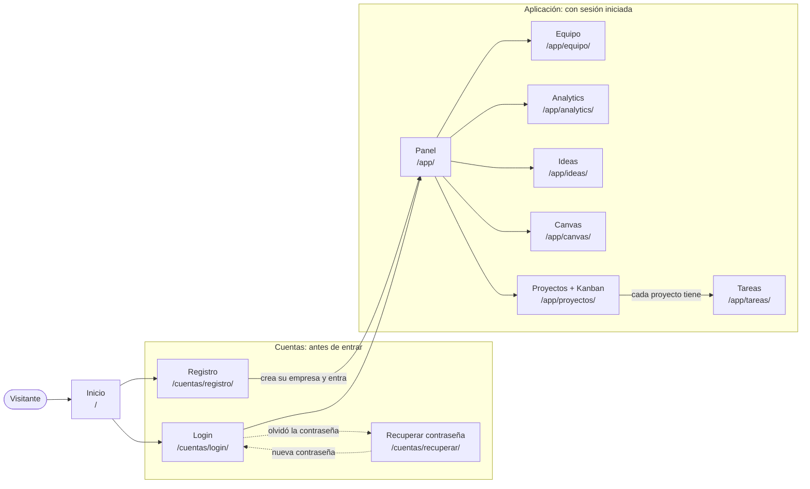

# Xincronix

Xincronix es una plataforma web donde las empresas organizan el trabajo de
sus equipos en un solo lugar: proyectos, tareas, ideas y una pizarra
compartida, con indicadores para ver cómo avanza todo.

---

## Product Goal

> Que cualquier empresa pueda organizar, repartir y seguir el trabajo de sus
> equipos desde una sola plataforma, donde cada persona ve solo lo que le
> corresponde.

**Entrega:** 1 de diciembre de 2026.

---

## Partes del proyecto

Para usar cualquier módulo primero hay que **registrarse** e **iniciar
sesión**. Al registrarse, la persona recibe su propia empresa y queda como
**Administrador**; desde ahí invita a su equipo.

| Módulo | Para qué sirve | Ruta | Necesitas antes |
|---|---|---|---|
| **Cuentas** | Crear la cuenta, entrar y recuperar la contraseña | `/cuentas/registro/` · `/cuentas/login/` | — |
| **Panel** | Ver de un vistazo cómo va el trabajo | `/app/` | Iniciar sesión |
| **Empresas y equipos** | Agrupar a las personas de la empresa en equipos, con su rol | `/app/equipo/` | Ser Administrador o Manager |
| **Proyectos** | Crear proyectos, sumar miembros y organizarlos en un Kanban | `/app/proyectos/` | Iniciar sesión |
| **Tareas** | Repartir el trabajo con responsable, prioridad y fecha | `/app/tareas/` | Tener un proyecto |
| **Analytics** | Medir el avance frente a las metas | `/app/analytics/` | Tener tareas |
| **Tablero de ideas** | Proponer y votar ideas en equipo | `/app/ideas/` | Iniciar sesión |
| **Canvas** | Diseñar en conjunto sobre una pizarra compartida | `/app/canvas/` | Iniciar sesión |

Todo funciona en **modo claro y oscuro**.

### Recorrido del usuario



### Ejemplo: crear un proyecto

1. **Regístrate** en `/cuentas/registro/` o **inicia sesión** en `/cuentas/login/`.
2. Llegas al **Panel** (`/app/`).
3. En la barra superior, entra a **Proyectos**.
4. Pulsa **Nuevo proyecto** y llena nombre, tipo, importancia, fechas y equipo.
5. El proyecto aparece en la lista y en la actividad reciente del panel.
6. Agrega **miembros** con su rol: responsable, colaborador u observador.
7. En el **Kanban**, crea tareas y muévelas: Por hacer → En progreso → En revisión → Completada.

### Qué puede hacer cada rol

| Acción | Administrador | Manager | Supervisor | Colaborador |
|---|---|---|---|---|
| Ver todos los proyectos de la empresa | ✅ | ✅ | ✅ | Solo donde participa |
| Crear proyectos, tareas e ideas | ✅ | ✅ | ✅ | ✅ |
| Editar cualquier proyecto | ✅ | ✅ | ❌ | Solo donde es miembro |
| Agregar usuarios y crear equipos | ✅ | ✅ | ❌ | ❌ |
| Editar un lienzo compartido | ✅ | ✅ | Solo ver | Según el permiso que le den |

Nadie ve nunca la información de otra empresa.

---

## Sprint actual — Sprint 2

| Módulos | Responsable | Fechas |
|---|---|---|
| Empresas y equipos · Panel | Felipe ([@FelipeNavarrete0313](https://github.com/FelipeNavarrete0313)) | 16 – 20 de noviembre de 2026 |

### Sprint Goal

> Cada empresa organiza a su gente en equipos y conoce de un vistazo el estado
> real de su trabajo, sin tener que preguntarle a cada persona.

**Qué entrega este sprint:**
- Cada empresa tiene sus propios usuarios, roles y equipos, separados de las demás.
- Cada persona ve solo los proyectos y la información que le corresponden.
- El panel muestra el resumen real del trabajo: proyectos activos, tareas
  completadas y vencidas, actividad reciente y avance de cada proyecto.

El plan de todos los sprints (historias de usuario, story points y criterios
de aceptación) está en [`docs/plan_sprints.md`](docs/plan_sprints.md).

---

## Tecnologías y requisitos

- **Python 3.10+** con **Django 5.2**
- **Base de datos:** SQLite (desarrollo) o MariaDB 10.5+ / MySQL 8+
- **Interfaz:** Bootstrap 5.3, Bootstrap Icons y Chart.js
- **Git** y **pip**

> El XAMPP con MariaDB 10.4 **no** es compatible con Django 5.2.

---

## Instalación

```bash
# 1. Clonar el repositorio
git clone https://github.com/kevincomunicate-tech/XINCRONIX.git
cd XINCRONIX

# 2. Crear y activar el entorno virtual
python -m venv .venv
#    Windows (PowerShell):  .venv\Scripts\Activate.ps1
#    Linux / macOS:         source .venv/bin/activate

# 3. Instalar las dependencias
pip install -r requirements.txt

# 4. Crear el archivo .env (y cambiar la clave secreta)
#    Windows:        copy .env.example .env
#    Linux / macOS:  cp .env.example .env

# 5. Crear las tablas de la base de datos
python manage.py migrate

# 6. (Opcional) Crear un administrador para /admin
python manage.py createsuperuser

# 7. Iniciar el servidor
python manage.py runserver
```

Abre http://127.0.0.1:8000

### Uso diario

```bash
source .venv/bin/activate      # o .venv\Scripts\Activate.ps1 en Windows
python manage.py migrate       # por si alguien cambió los modelos
python manage.py runserver
```

Si instalas un paquete nuevo: `pip install paquete` y luego `pip freeze > requirements.txt`.

En desarrollo, los correos de **recuperar contraseña** no se envían: se
imprimen en la terminal donde corre `runserver`.

---

## Base de datos

Por defecto se usa **SQLite**, sin instalar nada. Para usar **MariaDB/MySQL**
(por ejemplo, con phpMyAdmin), crea la base vacía `xincronix_bd`
(`utf8mb4_unicode_ci`), configura `.env` y corre `python manage.py migrate`:

```
DB_ENGINE=mysql
DB_NAME=xincronix_bd
DB_USER=root
DB_PASSWORD=
DB_HOST=127.0.0.1
DB_PORT=3306
```

El diagrama entidad-relación está en [`docs/modelo_datos.md`](docs/modelo_datos.md)
y la estructura en SQL en [`docs/xincronix_bd.sql`](docs/xincronix_bd.sql).

> Borra los datos desde la aplicación o desde `/admin`, no con `DELETE`
> directo en phpMyAdmin.

---

## Estructura

```
XINCRONIX/
├── config/          configuración general (settings, urls)
├── cuentas/         cuentas, empresas, roles y equipos
├── dashboard/       panel, proyectos, tareas, analytics, ideas y canvas
├── comunicacion/    mensajes, reuniones, calendario, asistente IA y soporte
├── sitio/           página pública de inicio
├── templates/       plantillas base
├── static/          CSS, JS e imágenes
├── docs/            modelo de datos y plan de sprints
├── scripts/         publicar el backlog en GitHub
├── requirements.txt dependencias
└── .env.example     guía para crear .env
```

---

## Pruebas

```bash
python manage.py test
```

---

## Flujo de trabajo con Git

- `main` solo recibe cambios revisados.
- Cada historia va en su propia rama: `feature/HU-18-listado-proyectos`.
- Los cambios entran por **pull request**, revisado por otra persona.
- En el pull request escribe `Closes #N` para cerrar el issue al unirlo.

### Definición de terminado

Una historia está terminada cuando cumple sus criterios de aceptación, tiene
pruebas y `python manage.py test` pasa, funciona en modo claro, oscuro y en
móvil, respeta los permisos, incluye su migración si cambia el modelo de datos
y su pull request fue revisado por otra persona.
