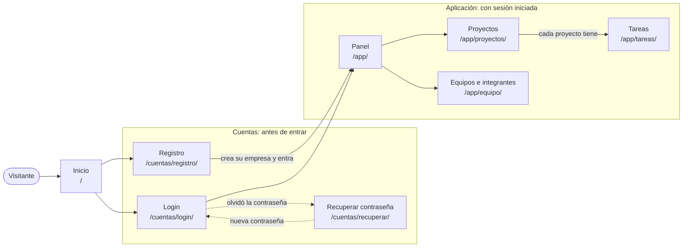

# Xincronix

Xincronix es una plataforma para planificar proyectos tecnológicos de forma
individual o en equipo, organizar su trabajo en un tablero Kanban y vincular
repositorios públicos, issues y pull requests de GitHub como referencias.

---

## Product Goal

> Que cualquier empresa pueda organizar, repartir y seguir el trabajo de sus
> equipos desde una sola plataforma, donde cada persona ve solo lo que le
> corresponde.

**Entrega:** 1 de diciembre de 2026.

---

## Módulos disponibles

Para usar cualquier módulo primero hay que **registrarse** e **iniciar
sesión**. Al registrarse, la persona recibe su propia empresa y queda como
**Administrador**. Admin y Manager pueden crear y administrar integrantes; al
crear una cuenta de integrante se define su contraseña inicial.

| Módulo | Funcionalidad | Ruta |
|---|---|---|
| **Cuentas** | Registro de empresa, inicio de sesión y recuperación de contraseña | `/cuentas/registro/` · `/cuentas/login/` |
| **Panel** | Resumen de proyectos y tareas visibles para la persona | `/app/` |
| **Empresas y equipos** | CRUD de integrantes, roles y equipos, aislados por empresa | `/app/equipo/` · `/app/equipo/miembros/` |
| **Proyectos** | CRUD de proyectos individuales o de equipo, con fechas, prioridad y repositorio público opcional | `/app/proyectos/` |
| **Tareas** | Tablero Kanban por estado y CRUD de tareas, con responsable, prioridad y fecha límite | `/app/tareas/` |
| **Analytics** | Resumen de proyectos y tareas visibles, avance, vencimientos y próximos plazos | `/app/analytics/` |
| **Referencias GitHub** | Guardar enlaces de un repositorio, issues y pull requests; sin sincronización ni cambios en GitHub | Desde cada proyecto |

**Pendiente de implementar:** tablero de ideas, Canvas, asistente virtual,
automatizaciones y seguimiento de despliegues. Las rutas de ideas, Canvas y
automatizaciones aún muestran páginas provisionales. Analytics usa únicamente
proyectos visibles para la persona; la vinculación actual con GitHub guarda
enlaces manuales, no verifica la visibilidad del repositorio ni consulta su API.

Todo funciona en **modo claro y oscuro**.

### Recorrido del usuario



### Ejemplo: crear un proyecto

1. **Regístrate** en `/cuentas/registro/` o **inicia sesión** en `/cuentas/login/`.
2. Llegas al **Panel** (`/app/`).
3. En la barra superior, entra a **Proyectos**.
4. Pulsa **Crear proyecto** y llena nombre, descripción, prioridad, fechas y equipo.
5. Agrega integrantes activos de la misma empresa al proyecto.
6. Desde el tablero, crea tareas y asígnales estado, prioridad, responsable y fecha límite.
7. Si el proyecto tiene un repositorio público, agrega enlaces a sus issues y pull requests desde **Referencias**.

### Qué puede hacer cada rol

| Acción | Administrador | Manager | Supervisor | Colaborador |
|---|---|---|---|---|
| Ver todos los proyectos de la empresa | ✅ | ✅ | ✅ | Solo donde participa |
| Crear proyectos y tareas | ✅ | ✅ | ✅ | ✅ |
| Editar cualquier proyecto | ✅ | ✅ | ❌ | Solo donde es miembro |
| Agregar integrantes y crear equipos | ✅ | ✅ | ❌ | ❌ |
| Consultar Analytics | Proyectos de la empresa | Proyectos de la empresa | Proyectos de la empresa | Solo donde participa |
| Ver ideas y Canvas | En construcción | En construcción | En construcción | En construcción |

Nadie ve nunca la información de otra empresa.

---

## Sprint 2 — base implementada

| Módulos | Responsable | Fechas |
|---|---|---|
| Empresas y equipos · Panel | Felipe ([@FelipeNavarrete0313](https://github.com/FelipeNavarrete0313)) | 16 – 20 de noviembre de 2026 |

### Sprint Goal

> Cada empresa organiza a su gente en equipos y conoce de un vistazo el estado
> real de su trabajo, sin tener que preguntarle a cada persona.

**Incluido en esta entrega:**
- Cada empresa tiene sus propios usuarios, roles y equipos, separados de las demás.
- Cada persona ve solo los proyectos y la información que le corresponden.
- El panel muestra conteos reales de proyectos y tareas, completadas y vencidas.

---

## Tecnologías y requisitos

- **Python 3.10+** con **Django 5.2**
- **Base de datos:** SQLite
- **Interfaz:** Bootstrap 5.3 y Bootstrap Icons (cargados desde CDN)
- **Git** y **pip**

---

## Instalación

```bash
# 1. Clonar el repositorio
git clone https://github.com/kevincomunicate-tech/XINCRONIX.git
cd XINCRONIX

# 2. Crear y activar el entorno virtual
python -m venv .venv
#    Windows (PowerShell):  .venv\Scripts\Activate.ps1
#    Linux / macOS:         source .venv/bin/activate

# 3. Instalar las dependencias
pip install -r requirements.txt

# 4. Opcional para desarrollo local: copiar la configuración de ejemplo
#    Windows:        copy .env.example .env
#    Linux / macOS:  cp .env.example .env
#    En producción, configurar una clave secreta segura y DEBUG=False.

# 5. Crear las tablas de la base de datos
python manage.py migrate

# 6. (Opcional) Crear un administrador para /admin
python manage.py createsuperuser

# 7. Iniciar el servidor
python manage.py runserver
```

Abre http://127.0.0.1:8000

### Uso diario

```bash
source .venv/bin/activate      # o .venv\Scripts\Activate.ps1 en Windows
python manage.py migrate       # por si alguien cambió los modelos
python manage.py runserver
```

Si instalas un paquete nuevo: `pip install paquete` y luego `pip freeze > requirements.txt`.

En desarrollo, los correos de **recuperar contraseña** no se envían: se
imprimen en la terminal donde corre `runserver`.

---

## Base de datos

SQLite se configura automáticamente y no requiere un servidor aparte. Las
migraciones crean las tablas y asignan un espacio de trabajo aislado a cada
cuenta existente. Para cambiar a otro motor se debe configurar primero el
backend y su controlador en `config/settings.py`.

---

## Estructura

```
XINCRONIX/
├── config/          configuración general (settings, urls)
├── cuentas/         cuentas, empresas, roles y equipos
├── dashboard/       panel, equipos, proyectos y tareas
├── sitio/           página pública de inicio
├── templates/       plantillas base
├── static/          CSS, JS e imágenes
├── requirements.txt dependencias
└── .env.example     guía para crear .env
```

---

## Pruebas

```bash
python manage.py test
```

---

## Flujo de trabajo con Git

- `main` solo recibe cambios revisados.
- Cada historia va en su propia rama: `feature/HU-18-listado-proyectos`.
- Los cambios entran por **pull request**, revisado por otra persona.
- En el pull request escribe `Closes #N` para cerrar el issue al unirlo.

### Definición de terminado

Una historia está terminada cuando cumple sus criterios de aceptación, tiene
pruebas y `python manage.py test` pasa, funciona en modo claro, oscuro y en
móvil, respeta los permisos, incluye su migración si cambia el modelo de datos
y su pull request fue revisado por otra persona.
