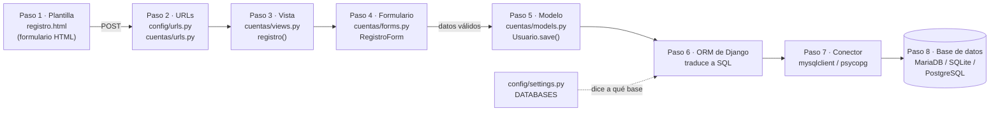
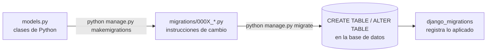

# Guía: la base de datos de Xincronix en Django

**Aprendiz:** Yohan Fernando Cuéllar Ospino · Ficha 3388087
**Proyecto:** Xincronix (rama `feature/django-migration-normalized-schema`)

Esta guía responde cuatro preguntas:

1. ¿El proyecto está llenando completamente la base de datos?
2. ¿En qué archivos se capturan los datos y cuál los envía a la base?
3. ¿Cómo conecto el proyecto a cualquier motor de base de datos?
4. ¿Cómo paso de XAMPP (MariaDB) a `db.sqlite3`?

> **Cómo leer los comandos:** cada comando va en su propio bloque e indica
> dónde se ejecuta. Donde dice "con el entorno activado" primero activa la
> `.venv` (sección 3.1).

---

## 1. ¿El proyecto está llenando completamente la base de datos?

**Sí, la estructura está completa:** las migraciones crearon las 18 tablas.
De ellas, 8 son de Xincronix y 10 son propias de Django (usuarios, permisos,
sesiones, historial de migraciones…).

**Los datos están parcialmente cargados**, como es normal en un proyecto en
desarrollo:

| Tabla | Filas | ¿Está bien? |
|---|---|---|
| `roles` | 4 | ✅ Los crea la migración `cuentas/0002_roles_iniciales` |
| `empresa` | 2 | ✅ Empresa demo y Nekros |
| `usuarios` | 2 | ✅ El superusuario y tu cuenta |
| `equipos` | 1 | ✅ |
| `miembros_equipo` | 1 | ✅ |
| `proyecto` | 3 | ⚠️ El proyecto 2 tiene un creador de otra empresa (ver abajo) |
| `tareas` | 9 | ⚠️ Revisar responsables y vencidas (ver abajo) |
| `actividad` | 12 | ✅ |
| `proyecto_miembros` | **0** | ⚠️ Falta llenarla |
| `auth_group`, `auth_group_permissions`, `usuarios_groups`, `usuarios_user_permissions`, `django_admin_log` | 0 | ✅ Normal: no has creado grupos ni editado desde `/admin` |
| `django_session` | 1 | ⚠️ Es una sesión abierta (ver abajo) |
| `auth_permission`, `django_content_type`, `django_migrations` | 56 / 14 / 22 | ✅ Los llena Django solo |

### Lo que encontré en el volcado del 21 de noviembre

Lo comprobé importando tu volcado y corriendo `sql/verificar_datos.sql`, que
solo hace consultas `SELECT`:

1. **El proyecto 2 ("App de inventario") sigue con un creador de otra
   empresa.** Es de la Empresa demo (id 1), pero su creador
   (`id_creador = 2`) es de Nekros (id 2). Ese dato **no quedó corregido**
   en el volcado.
2. **`proyecto_miembros` está vacía.** Ninguno de los 3 proyectos tiene
   miembros directos; solo el equipo asignado.
3. **Nekros no tiene equipos ni proyectos.**
4. **El superusuario (id 1) no tiene nombres ni apellidos.**
5. **Tareas 4, 5 y 8 sin responsable.**
6. **Tarea 6 ("Pantalla de productos") vencida** el 20 de noviembre y
   todavía en revisión.
7. **Fechas imposibles en los datos de ejemplo:**
   - Las tareas 1, 2 y 5 aparecen completadas milésimas de segundo
     **antes** de crearse.
   - Las 12 actividades tienen fechas **anteriores** a la creación de su
     proyecto.

   Pasa porque el script de datos de ejemplo inventó las fechas de la
   actividad y guardó la tarea completada antes de su fecha de creación. No
   rompe nada, pero si se ve en una sustentación conviene regenerar los
   datos de ejemplo.
8. **Las descripciones de empresas, equipos, proyectos y tareas están vacías.**
9. **El volcado incluye una sesión vigente hasta el 5 de diciembre**, además
   de correos reales y los *hash* de las contraseñas. Con esa sesión
   alguien podría entrar a tu cuenta sin contraseña. Ver la sección 7.
10. **phpMyAdmin no exportó bien la tabla `proyecto`.** En el `.sql` la
    tabla termina en `) ;` y le faltan las reglas `CHECK` ("fecha de fin ≥
    fecha de inicio" e "importancia de 1 a 4"). Si recreas la base desde ese
    archivo, esas reglas **se pierden**. Por eso, para reconstruir la base
    usa siempre `migrate` + `loaddata` (sección 4), nunca el volcado de
    phpMyAdmin.

La sección 7 explica cómo corregir cada punto.

---

## 2. ¿Dónde se capturan los datos y quién los envía a la base?

### 2.1 El recorrido de un dato

Ejemplo: alguien se registra en `/cuentas/registro/`.



| Paso | Archivo | Qué hace con el dato |
|---|---|---|
| 1 | `cuentas/templates/cuentas/registro.html` | **Captura**: muestra el formulario y la persona escribe nombre, correo y contraseña. El `` protege el envío. |
| 2 | `config/urls.py` → `cuentas/urls.py` | **Enruta**: la dirección `/cuentas/registro/` llega a la vista `registro`. |
| 3 | `cuentas/views.py` | **Recibe** la petición (`request.POST`) y crea el formulario con esos datos. |
| 4 | `cuentas/forms.py` | **Valida y limpia** (correo repetido, contraseña segura…). Si algo falla, vuelve a la plantilla con los errores y **no** se guarda nada. Si todo está bien, deja los datos en `cleaned_data`. |
| 5 | `cuentas/models.py` | **Define la tabla** (`usuarios`) y guarda con `create_user()` → `save()`. |
| 6 | El ORM de Django | **Traduce** `save()` a SQL: `INSERT INTO usuarios (...) VALUES (...)`. |
| 7 | El conector (`mysqlclient`, `psycopg` o el `sqlite3` de Python) | **Envía** el SQL al servidor. |
| 8 | El motor (MariaDB en XAMPP) | **Guarda** la fila. phpMyAdmin solo la muestra después. |

**¿Cuál "envía" los datos a la base?** El **modelo**, cuando el código llama
a `.save()`, `objects.create()` o `create_user()`. Esa llamada hace que el
ORM genere el SQL y el conector lo mande. **Ninguna plantilla ni vista
escribe SQL a mano.**

**¿A qué base los envía?** A la que diga `DATABASES` en `config/settings.py`,
que lee los datos de conexión del `.env`.

### 2.2 Otras entradas de datos

| Por dónde entra | Archivos | Ejemplo |
|---|---|---|
| Formularios de la app | `templates/` → `urls.py` → `views.py` → `forms.py` → `models.py` | Registro, crear proyecto, crear tarea |
| Panel de administración `/admin` | `cuentas/admin.py`, `dashboard/admin.py` | Editar el creador de un proyecto |
| Migraciones de datos | `cuentas/migrations/0002_roles_iniciales.py` | Los 4 roles |
| Comandos o scripts | El script con el que cargaste los datos de ejemplo | Empresa demo, proyectos y tareas |
| Consola de Django | `python manage.py shell` | Pruebas rápidas |

### 2.3 La estructura (las tablas) no viene de phpMyAdmin



- `models.py` dice **cómo debe ser** cada tabla.
- `makemigrations` escribe en `migrations/` **qué cambiar**.
- `migrate` ejecuta esos cambios en la base y lo anota en `django_migrations`.

**Por eso nunca se crean tablas ni usuarios con `INSERT` en phpMyAdmin.** Si
lo haces, la base y los modelos dejan de coincidir, y las contraseñas no
quedan cifradas.

### 2.4 Ver el SQL que Django envía

En tu `.env` pon:

```
DJANGO_LOG_SQL=True
```

Al usar la app, la terminal de `runserver` muestra cada consulta. Por
ejemplo, al crear un equipo:

```
INSERT INTO `equipos` (`nombre`, `descripcion`, `id_empresa`, `fecha_creacion`) VALUES ('Diseño', '', 1, '2026-11-21 20:03:46')
```

Para ver el SQL que generaría una migración, sin ejecutarla:

**CMD de Windows o terminal de Linux Mint (con el entorno activado):**
```
python manage.py sqlmigrate cuentas 0001
```

Cuando termines de mirar, vuelve a `DJANGO_LOG_SQL=False`. Si no, la
terminal se llena de texto.

---

## 3. Conectar el proyecto con cualquier motor de base de datos

El `settings.py` nuevo permite elegir el motor en el `.env` con **una sola
línea**, `DB_ENGINE`. Los modelos y las migraciones **no cambian**.

| Motor | `DB_ENGINE` | Conector (`pip install`) | Puerto | ¿Necesita servidor? |
|---|---|---|---|---|
| **SQLite** | `sqlite` | ninguno (viene con Python) | — | No, es un archivo |
| **MariaDB / MySQL** (XAMPP) | `mysql` | `mysqlclient` | 3306 (o 3307) | Sí |
| **PostgreSQL** | `postgresql` | `psycopg[binary]` | 5432 | Sí |

> Django 5.2 necesita **MariaDB 10.5+**, **MySQL 8.0.11+**, **PostgreSQL 14+**
> o **SQLite 3.31+**. Tu XAMPP con MariaDB 10.11 sirve.
>
> Si no pones `DB_ENGINE`, el proyecto sigue usando MySQL/MariaDB como hasta ahora.

### 3.1 Pasos comunes (para cualquier motor)

**Paso 1. Abrir una terminal en la carpeta del proyecto y activar el entorno.**

CMD de Windows:
```
.venv\Scripts\activate
```

Terminal de Linux Mint o Codespaces:
```
source .venv/bin/activate
```

*Por qué:* así `pip` y `python` usan los paquetes del proyecto y no los del
sistema. En el SENA no necesitas permisos de administrador para esto.

**Paso 2. Instalar el conector del motor.** Solo el que vayas a usar (ver
cada motor abajo).

**Paso 3. Crear la base y un usuario con permisos solo sobre ella.** Nunca
`GRANT ALL ON *.*`.

**Paso 4. Escribir los datos de conexión en `.env`.** Ábrelo en VS Code; la
contraseña va **solo** en ese archivo, nunca en el chat ni en GitHub.

**Paso 5. Comprobar que Django se conecta.**

CMD de Windows o terminal de Linux Mint (con el entorno activado):
```
python manage.py check --database default
```

*Por qué:* revisa la configuración y prueba la conexión antes de tocar nada.
Debe decir `System check identified no issues`.

**Paso 6. Crear las tablas.**

CMD de Windows o terminal de Linux Mint (con el entorno activado):
```
python manage.py migrate
```

*Por qué:* aplica todas las migraciones (incluye los 4 roles) en la base nueva.

**Paso 7. Crear tu administrador en esa base.** Cada base tiene sus propios
usuarios.

CMD de Windows o terminal de Linux Mint (con el entorno activado):
```
python manage.py createsuperuser
```

*Por qué:* crea el usuario con la contraseña cifrada. Nunca con `INSERT`.

**Paso 8. Confirmar a qué base quedó conectado.**

CMD de Windows o terminal de Linux Mint (con el entorno activado):
```
python manage.py shell -c "from django.db import connection; print(connection.vendor, connection.settings_dict['NAME'])"
```

*Por qué:* imprime el motor (`mysql`, `sqlite` o `postgresql`) y el nombre de
la base, para estar seguro de dónde estás guardando.

### 3.2 MariaDB / MySQL (XAMPP), que es lo que usas hoy

1. En el panel de XAMPP, pulsa **Start** en **MySQL**.
2. Crea la base y el usuario limitado con tu archivo `crear_usuario_xampp.sql`
   en phpMyAdmin (pestaña **SQL**), o con este contenido:

   **Cliente SQL (phpMyAdmin → SQL, o `mysql -u root`):**
   ```sql
   CREATE DATABASE IF NOT EXISTS xincronix_bd CHARACTER SET utf8mb4 COLLATE utf8mb4_unicode_ci;
   CREATE USER IF NOT EXISTS 'xincronix_user'@'localhost' IDENTIFIED BY 'escribe-tu-contrasena-aqui';
   GRANT ALL PRIVILEGES ON xincronix_bd.* TO 'xincronix_user'@'localhost';
   GRANT ALL PRIVILEGES ON test_xincronix_bd.* TO 'xincronix_user'@'localhost';
   FLUSH PRIVILEGES;
   ```
   *Por qué:* el usuario solo puede tocar la base del proyecto y la de pruebas.

3. Instala el conector:

   CMD de Windows o terminal de Linux Mint (con el entorno activado):
   ```
   pip install mysqlclient
   ```

4. En `.env`:
   ```
   DB_ENGINE=mysql
   DB_NAME=xincronix_bd
   DB_USER=xincronix_user
   DB_PASSWORD=la-contrasena-del-usuario
   DB_HOST=127.0.0.1
   DB_PORT=3306
   ```
   Si usas el MariaDB aparte del PC del SENA, el puerto es `DB_PORT=3307`.

5. Sigue con los pasos 5 a 8 de la sección 3.1.

### 3.3 SQLite

No hay que instalar ni crear nada: Django crea el archivo `db.sqlite3` en la
carpeta del proyecto.

1. En `.env`:
   ```
   DB_ENGINE=sqlite
   ```
   Las demás variables `DB_*` se ignoran. Puedes dejarlas.
2. Sigue con los pasos 5 a 8 de la sección 3.1.

*Cuándo usarlo:* para practicar en un computador sin XAMPP o en Codespaces.
No es la mejor opción para producción con muchas personas a la vez.

### 3.4 PostgreSQL

1. Instala PostgreSQL. En Linux Mint (pide tu contraseña de sistema):

   Terminal de Linux Mint:
   ```
   sudo apt install postgresql
   ```

   En Windows sin permisos de administrador no se puede instalar en el SENA:
   usa Codespaces o tu portátil.

2. Entra al cliente de PostgreSQL como administrador:

   Terminal de Linux Mint:
   ```
   sudo -u postgres psql
   ```

3. Crea el usuario y la base. `CREATEDB` hace falta para que `manage.py
   test` pueda crear su base de pruebas:

   **Cliente SQL (psql):**
   ```sql
   CREATE ROLE xincronix_user LOGIN PASSWORD 'escribe-tu-contrasena-aqui' CREATEDB;
   CREATE DATABASE xincronix_bd OWNER xincronix_user ENCODING 'UTF8';
   ```
   Sal con `\q`.

4. Instala el conector:

   CMD de Windows o terminal de Linux Mint (con el entorno activado):
   ```
   pip install "psycopg[binary]"
   ```

5. En `.env`:
   ```
   DB_ENGINE=postgresql
   DB_NAME=xincronix_bd
   DB_USER=xincronix_user
   DB_PASSWORD=la-contrasena-del-usuario
   DB_HOST=127.0.0.1
   DB_PORT=5432
   ```
6. Sigue con los pasos 5 a 8 de la sección 3.1.

### 3.5 Después de instalar un conector

Si el conector se va a quedar en el proyecto, regístralo en
`requirements.txt` y avísale al equipo en el pull request.

CMD de Windows o terminal de Linux Mint (con el entorno activado):
```
pip freeze > requirements.txt
```

⚠️ **Este comando sobrescribe `requirements.txt`.** Antes revisa con
`git diff requirements.txt` que solo cambió lo que esperabas.

---

## 4. Pasar de XAMPP (MariaDB) a `db.sqlite3`

**Aclaración:** en Django no existe un archivo `migration.py`. Las
migraciones están en la carpeta `migrations/` de cada app (`cuentas/`,
`dashboard/`) y **no se tocan** al cambiar de motor: el mismo
`0001_initial.py` crea las tablas en MariaDB, en SQLite o en PostgreSQL.

Lo único que cambia es `DB_ENGINE` en el `.env`. Lo que **no** pasa solo
son los **datos**: la base SQLite nueva empieza vacía.

### Opción A: empezar con SQLite vacío

1. En `.env`, cambia a `DB_ENGINE=sqlite`.
2. Sigue con los pasos 5 a 8 de la sección 3.1.

### Opción B: llevarte los datos de MariaDB a SQLite (probado)

**Paso 1.** Con `DB_ENGINE=mysql` todavía en el `.env`, exporta los datos a
un archivo JSON:

CMD de Windows o terminal de Linux Mint (con el entorno activado):
```
python manage.py dumpdata --natural-foreign --natural-primary -e contenttypes -e auth.Permission -e admin.LogEntry -e sessions --indent 2 -o datos.json
```

*Por qué cada parte:*
- `dumpdata` lee los datos **a través de los modelos**, sin importar el motor.
- `--natural-foreign --natural-primary` evita depender de los ids internos
  de Django, que cambian entre bases.
- `-e …` excluye lo que Django regenera solo (tipos de contenido y
  permisos), el historial del admin y las **sesiones**, que no se deben copiar.
- `-o datos.json` guarda el resultado en un archivo.

⚠️ `datos.json` contiene **correos reales y los hash de las contraseñas**.
Trátalo como el `.env`: no lo subas a GitHub ni lo compartas.

**Paso 2.** En `.env`, cambia a:
```
DB_ENGINE=sqlite
```

**Paso 3.** Crea las tablas en SQLite:

CMD de Windows o terminal de Linux Mint (con el entorno activado):
```
python manage.py migrate
```

**Paso 4.** Importa los datos:

CMD de Windows o terminal de Linux Mint (con el entorno activado):
```
python manage.py loaddata datos.json
```

*Por qué:* guarda cada objeto con los modelos, así se respetan las
relaciones y las contraseñas siguen sirviendo. En la prueba se importaron
13 objetos, los conteos quedaron idénticos en las dos bases y el login
funcionó con la misma contraseña.

**Paso 5.** Comprueba los conteos:

CMD de Windows o terminal de Linux Mint (con el entorno activado):
```
python manage.py shell -c "from cuentas import models as c; from dashboard import models as d; print({m.__name__: m.objects.count() for m in [c.Empresa, c.Usuario, d.Proyecto, d.Tarea]})"
```

Si en tu rama `Equipo` está en `dashboard`, agrégalo a la lista como `d.Equipo`.

**Paso 6.** Cuando ya no lo necesites, borra `datos.json`.

⚠️ Esto **borra el archivo de forma permanente**. Antes confirma que la
importación salió bien (paso 5).

CMD de Windows:
```
del datos.json
```

Terminal de Linux Mint:
```
rm datos.json
```

### Volver a MariaDB

Cambia otra vez `DB_ENGINE=mysql` en el `.env`. La base `xincronix_bd` de
XAMPP sigue intacta: cambiar de motor **no borra** la otra base.

---

## 5. Verificaciones de que todo está en orden

Con el entorno activado, en CMD de Windows o en la terminal de Linux Mint:

**1. Los modelos y las migraciones coinciden.**
```
python manage.py makemigrations --check --dry-run
```
Debe decir `No changes detected`. Si dice otra cosa, alguien cambió un
modelo sin crear su migración.

**2. Todas las migraciones están aplicadas.**
```
python manage.py showmigrations
```
Todas deben tener `[X]`.

**3. No hay migraciones pendientes por aplicar.**
```
python manage.py migrate
```
Debe decir `No migrations to apply.`

**4. Las pruebas pasan.** Usan la base `test_xincronix_bd` y no tocan tus datos.
```
python manage.py test
```

**5. Los nombres reales de los campos del usuario.** Sirve para revisar
`AUTH_PASSWORD_VALIDATORS`, en el punto siguiente.
```
python manage.py shell -c "from cuentas.models import Usuario; print([f.name for f in Usuario._meta.fields])"
```

Tu `settings.py` tiene
`"user_attributes": ("nombres", "apellidos", "email")`. Ese validador busca
**atributos del modelo**, no columnas de la tabla. Si el comando anterior
muestra `first_name` y `last_name` (y `nombres`/`apellidos` solo son el
`db_column`), cámbialo a `("first_name", "last_name", "email")`. Si no, el
validador no compara la contraseña con el nombre y **no avisa** del error.

**6. `.gitignore` protege los archivos sensibles.** Debe tener estas líneas:
```
.env
*.sql
datos*.json
db.sqlite3
```

**7. Revisión de los datos.** Corre `sql/verificar_datos.sql` en phpMyAdmin
(pestaña **SQL**). Solo hace consultas. Las consultas 2, 3 y 4 deben salir
vacías. En una base creada con `migrate`, la 12 muestra **tres** reglas
`CHECK` en `proyecto` (`nivel_importancia`, `ck_proyecto_fechas` y
`ck_proyecto_importancia`). Si solo aparece `nivel_importancia`, la tabla
perdió sus reglas, por ejemplo por haberla importado desde un `.sql` de
phpMyAdmin, y hay que recrearla con `migrate` (sección 4).

---

## 6. ¿Por qué no recrear la base desde el `.sql` de phpMyAdmin?

- **Pierde las reglas `CHECK`** de la tabla `proyecto` (punto 10 de la
  sección 1).
- **Arrastra sesiones abiertas** y datos personales.
- **Los volcados con datos reales no se comparten**, por las reglas del curso.

**La forma correcta:** la estructura la crea `migrate`, y los datos se
mueven con `dumpdata`/`loaddata` o se cargan con un script de datos de
ejemplo.

---

## 7. Cómo corregir lo que encontré

Todo se hace **desde la aplicación o desde `/admin`**, no con `UPDATE` ni
`DELETE` en phpMyAdmin. Así se respetan las reglas de los modelos.

| # | Problema | Cómo corregirlo |
|---|---|---|
| 1 | Proyecto 2 con creador de otra empresa | `/admin/` → **Proyectos** → *App de inventario* → **Creado por**: el superusuario (Empresa demo) → Guardar |
| 2 | `proyecto_miembros` vacía | `/admin/` → **Proyectos** → cada proyecto → agrega miembros con su rol (responsable, editor u observador) |
| 3 | Nekros sin equipos ni proyectos | Entra con tu cuenta de Nekros y crea un equipo y un proyecto desde la app (o desde `/admin`) |
| 4 | Superusuario sin nombre | `/admin/` → **Usuarios** → id 1 → Nombres y Apellidos |
| 5 | Tareas 4, 5 y 8 sin responsable | `/admin/` → **Tareas** → **Asignado a** |
| 6 | Tarea 6 vencida en revisión | Cambia el estado a *Completada* o pon una fecha de vencimiento nueva |
| 7 | Fechas imposibles | Si las vas a mostrar en la sustentación, vuelve a generar los datos de ejemplo |
| 8 | Descripciones vacías | Llénalas desde `/admin` o desde la app |

### 7.1 Cerrar la sesión que quedó en el volcado

Esa sesión sigue vigente hasta el 5 de diciembre. Lo más simple es entrar a
la app con esa cuenta y pulsar **Cerrar sesión**: eso borra la fila de
`django_session`.

Si prefieres cerrar **todas** las sesiones de una vez:

⚠️ **Esto saca a todas las personas que tengan sesión abierta en esa base.**
Tendrán que volver a iniciar sesión.

CMD de Windows o terminal de Linux Mint (con el entorno activado):
```
python manage.py shell -c "from django.contrib.sessions.models import Session; print(Session.objects.all().delete())"
```

*Por qué:* borra todas las sesiones a través del modelo, así quedan
invalidadas las cookies `sessionid` que se hubieran copiado.

---

## 8. Resumen

| Pregunta | Respuesta corta |
|---|---|
| ¿Se llena la base? | La estructura sí, completa. Los datos están a medias: faltan miembros de proyecto y hay 3 datos por corregir. |
| ¿Quién captura los datos? | La plantilla (formulario), la vista los recibe y el formulario los valida. |
| ¿Quién los envía a la base? | El modelo, con `.save()` / `create()`. El ORM los traduce a SQL y el conector los manda. |
| ¿Cómo cambio de motor? | Cambiando `DB_ENGINE` en `.env` y corriendo `migrate`. Los modelos y las migraciones no cambian. |
| ¿Y si quiero mis datos en SQLite? | `dumpdata` con MariaDB → cambiar a `sqlite` → `migrate` → `loaddata`. |
