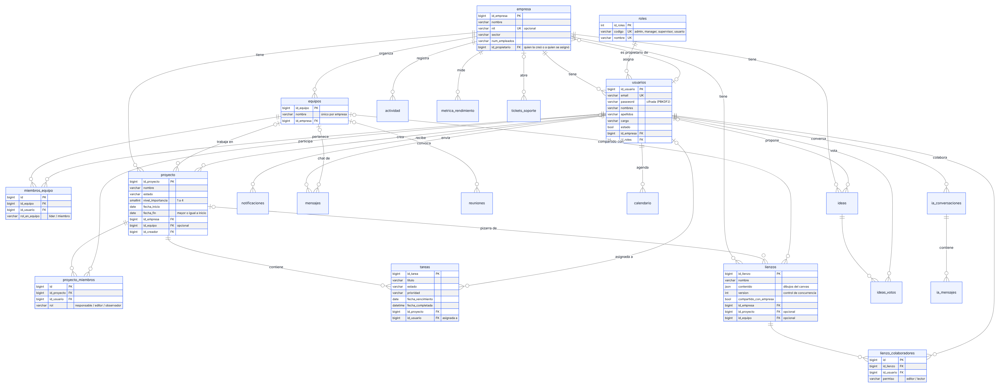
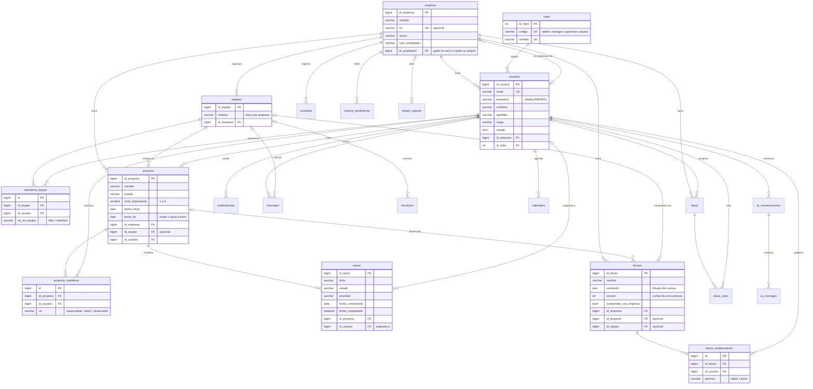

# Modelo de datos de Xincronix

Base de datos reconstruida a partir de `xincronix_bd` (la versión de
Laravel/Spring), **normalizada hasta 3FN**, sin las tablas de los
frameworks anteriores y con soporte para **trabajo en equipo** en
proyectos y en el canvas.

- Los modelos están en `cuentas/models.py`, `dashboard/models.py` y
  `comunicacion/models.py`.
- La estructura en SQL (para revisar en phpMyAdmin) está en
  [`xincronix_bd.sql`](xincronix_bd.sql).
- Para crear la base de verdad: `python manage.py migrate`.

## Diagrama entidad-relación

## Trabajo en equipo: quién ve y quién edita

**Proyectos** (`Proyecto.objects.visibles_para(usuario)` y `proyecto.permisos(usuario)`).
Las reglas están en `config/politica_accesos.json` → sección `proyectos`.

| Persona | Ve | Edita |
|---|---|---|
| Administrador o Manager de la empresa | ✅ todos | ✅ |
| Supervisor | ✅ todos | ❌ (seguimiento) |
| Quien creó el proyecto | ✅ | ✅ (y lo elimina) |
| Miembro directo: responsable o editor (puede ser de otra empresa) | ✅ | ✅ |
| Miembro directo: observador | ✅ | ❌ |
| Miembro del equipo asignado | ✅ | ✅ |
| Otra persona sin relación con el proyecto | ❌ | ❌ |

**Lienzos del canvas** (`Lienzo.objects.visibles_para(usuario)` y `lienzo.puede_editar(usuario)`)

Un lienzo es visible para su creador, los gestores de la empresa y,
además, para quien se haya compartido:

- **Personas** (`lienzo_colaboradores`) con permiso **editor** o **lector**.
- **Un equipo**: todos sus miembros pueden editar.
- **Un proyecto**: los que pueden editar el proyecto pueden editar su lienzo.
- **Toda la empresa** (`compartido_con_empresa`).

El dibujo se guarda completo en `contenido` (JSON). La columna `version`
sube en cada guardado: si dos personas guardan casi al mismo tiempo, la
segunda se entera de que el lienzo cambió y no pisa el trabajo de la otra.

## Qué cambió respecto a `xincronix_bd`

### Tablas eliminadas

| Tabla | Por qué |
|---|---|
| `cache`, `cache_locks`, `jobs`, `job_batches`, `failed_jobs`, `migrations`, `personal_access_tokens` | Eran de Laravel. Django usa sus propias tablas (`django_migrations`, `django_session`). |
| `flyway_schema_history` | Era de Spring Boot. La reemplazan las migraciones de Django. |
| `password_reset_tokens` | Django firma el enlace de recuperación sin guardar nada en la base. |
| `login_verification_codes` (+ `two_factor_*` en usuarios) | Se quitó el código por correo del login. Además su `id_usuario` era `int` con signo frente a `UNSIGNED` en `usuarios`, así que no tenía llave foránea. |
| `solicitudes_pago` (+ `plan_suscripcion` y `comprobante` en empresa) | El registro ya no incluye pago. `comprobante` guardaba una ruta local (`/home/yohan/Descargas/...`). |
| `perfiles_especificos` | Vacía y sin uso. `cargo` ya cumple esa función. |

### Columnas corregidas (normalización)

| Antes | Después | Regla |
|---|---|---|
| `tareas.id_equipo` | Se quita: el equipo sale de `tarea → proyecto → equipo` | **3FN**: dependía de otro campo que no es la llave (dependencia transitiva) y podía contradecir al proyecto. |
| `ia_conversaciones.id_empresa` | Se quita: sale de `conversación → usuario → empresa` | **3FN**, mismo caso. |
| `equipos.miembros` (un número) | Se quita: se cuenta en `miembros_equipo` | Dato **derivado**: se desactualizaba. |
| `empresa.administrador` (texto) | Se quita: es el usuario con rol Administrador | Repetía datos de `usuarios`. |
| `empresa.industria` y `empresa.sector` | Queda solo `sector` | Dos columnas para lo mismo. |
| `mensajes.estado` + `leido` | Queda solo `leido` | Dos columnas para lo mismo. |
| `notificaciones.estado` + `leida` | Queda solo `leida` | Dos columnas para lo mismo. |
| Rol `SUPERADMIN` y `cargo = "SUPERADMIN"` | `is_superuser` de Django | Separa permiso global, rol en la empresa y cargo laboral. |
| `reuniones.fecha` y `calendario.fecha_evento` con `ON UPDATE current_timestamp()` | Fecha normal | **Error**: al editar una reunión, su fecha cambiaba a "ahora". |
| `mensajes.id_destinatario` opcional y sin más | Destinatario **o** equipo (exactamente uno) | Regla `CHECK` en la base de datos. |
| `tickets_soporte` sin autor | `id_usuario` = quién lo abrió | Faltaba la relación. |
| `usuarios.password` en bcrypt (`$2y$`) | PBKDF2 de Django | Django cifra y verifica las contraseñas. |

### Tablas nuevas

| Tabla | Para qué |
|---|---|
| `proyecto_miembros` | Personas que trabajan en un proyecto, con su rol. |
| `lienzos`, `lienzo_colaboradores` | Canvas guardado en la base y compartido con personas, equipos o proyectos. |
| `ideas`, `ideas_votos` | Tablero de ideas compartido. Los votos se cuentan, no se guardan como número. |
| `actividad` | "Actividad reciente" del panel. |

### Reglas que ahora garantiza la base de datos

- `UNIQUE`: correo de usuario, NIT de empresa, nombre de equipo dentro
  de la empresa, una persona por equipo, por proyecto y por lienzo, y
  un voto por persona e idea.
- `CHECK`: fecha de fin ≥ inicio (proyectos y métricas), importancia
  entre 1 y 4, y mensaje con un solo destino.
- La regla "misma empresa" (no meter en un equipo a alguien de otra
  empresa) la valida Django en `clean()`.

## Borrar datos

En phpMyAdmin verás las llaves foráneas **sin `ON DELETE CASCADE`**.
Es normal: Django aplica el `on_delete` de cada modelo (`CASCADE`,
`SET_NULL`, `PROTECT`) por su cuenta. Por eso **borra siempre desde la
aplicación o desde `/admin`**, no con `DELETE` directo en phpMyAdmin.
